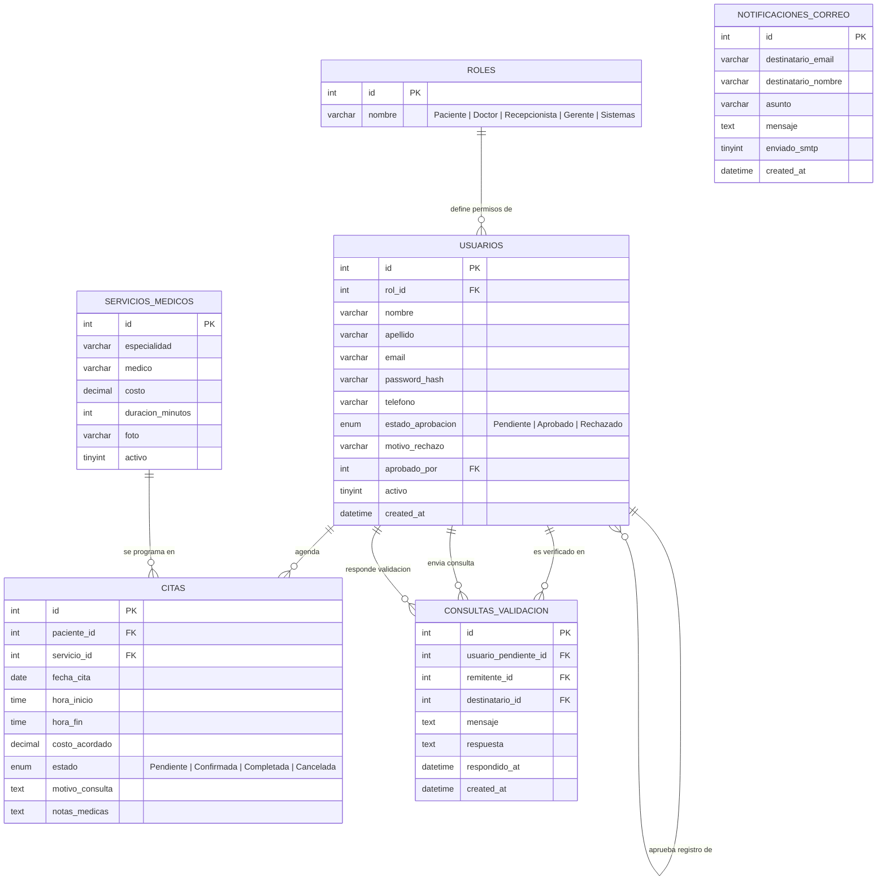

# Documentación del Proyecto — MedicApp

Este documento reúne la estructura de la base de datos, los pasos para levantar el proyecto en servidor local o hosting y las cuentas listas para probar el sistema clínico.

**Desarrollado por:** Equipo 3 Aracely Feliciano Juárez,
                               Estefania Suarez Ramos,
                               Karol Aimee Zarate Perez,
**Carrera:** Ingeniería en Sistemas Computacionales — 7° Semestre 

---

## 1. Diagrama Entidad-Relación (Base de Datos)

La base de datos `medicapp` (`if0_43450307_medicapp`) está diseñada en MySQL/MariaDB para gestionar el control de acceso por roles, la validación de identidad de nuevos usuarios, el catálogo de especialidades médicas, el agendamiento de citas sin traslapes de horario y el historial de notificaciones por correo.

